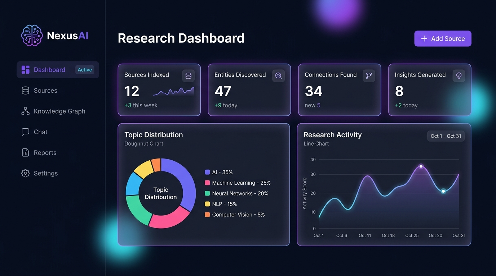

# 🧠 NexusAI — Intelligent Research & Knowledge Synthesis Platform



**NexusAI** is a full-stack AI-powered research platform that transforms scattered information into structured, interconnected knowledge. It combines a Node.js/Express backend, SQLite persistent database, server-side Cheerio web scraping, and Google's Gemini API with an interactive knowledge graph visualization and research synthesis engine.

> 🏆 **Built for [Global Innovation Build Challenge V2 (GIBC V2)](https://gibc-v2.devpost.com/) — Track 03: Open (General Technical Invention)**

---

## ✨ Features

### 📊 Research Dashboard
- Real-time analytics tracking sources indexed, entities discovered, connections found, and insights generated
- Interactive topic distribution doughnut chart and entity-type distribution bar chart
- Quick access to recent sources, full data export, and one-click sample research dataset loader

### 📁 Full-Stack Source Manager
- **Multi-Modal Ingestion**: Paste raw notes, research papers, or enter public URLs
- **Server-Side Web Scraping**: Ingests articles and cleans boilerplate using Cheerio
- **Entity Extraction**: Google Gemini neural extraction with intelligent offline rule-based fallback
- Automatic topic categorization and contextual summarization

### 🔗 Interactive Knowledge Graph
- Custom SVG force-directed graph engine with physics simulation and glow effects
- Click-to-inspect entity details with relationship mapping across all sources
- Categorized entity types: Technology, Concept, Organization, Person, Location, Event
- Zoom, pan, and responsive auto-centering controls

### 💬 Research Chat (Cited Q&A)
- Context-aware natural language Q&A across your entire indexed knowledge base
- Synthesizes answers citing specific sources in `[Source Title]` format
- Multi-turn conversation persistence in SQLite

### 📝 Executive Report Generation
- Comprehensive synthesis reports covering Executive Summary, Key Themes, Critical Entities, Cross-Source Insights, Knowledge Gaps, and Recommendations
- Persistent report archive with Markdown rendering and export

---

## 🛠️ Full-Stack Architecture

| Layer | Technology | Description |
|---|---|---|
| **Backend Server** | Node.js + Express (ES Modules) | RESTful API server handling scraping, AI orchestration, and persistence |
| **Database** | SQLite via `better-sqlite3` | High-performance relational database with WAL mode and foreign key integrity |
| **Web Scraping** | Cheerio | Server-side HTML parsing, semantic text extraction, and boilerplate removal |
| **AI / LLM** | Google Gemini API (2.0 Flash / Pro) | Structured JSON entity extraction, synthesis reports, and cited Q&A |
| **Frontend** | Vanilla JavaScript (ES6+) | Reactive SPA communicating via clean REST API client |
| **Styling** | Vanilla CSS3 | Modern dark theme, glassmorphism, glowing accents, and CSS grid |
| **Visualizations** | Custom SVG Engine + Chart.js | Custom force simulation for knowledge graph + Chart.js for topic analytics |
| **Icons & Fonts** | Lucide Icons + Google Fonts | Inter and JetBrains Mono typography with Lucide icons |

```
nexus-ai/
├── server.js              # Express REST API server & AI orchestration
├── database.js            # SQLite database schema, WAL mode, & indexes
├── gemini.js              # Google Gemini API integration module
├── scraper.js             # Server-side Cheerio web content scraper
├── package.json           # Dependencies and scripts (ES Modules)
├── .env.example           # Environment template (PORT, GEMINI_API_KEY)
├── screenshots/           # Application screenshots for hackathon submission
│   ├── dashboard.jpg
│   └── graph.jpg
├── data/
│   └── nexus.db           # SQLite persistent database file
└── public/
    ├── index.html         # Semantic HTML5 single-page application
    ├── style.css          # Design system (dark theme, glassmorphism, responsive)
    ├── app.js             # Frontend API client, graph simulation, & controllers
    └── nexus-favicon.svg  # SVG favicon
```

---

## 🚀 Getting Started

### Prerequisites
- [Node.js](https://nodejs.org/) v18 or later
- (Optional) [Google Gemini API key](https://aistudio.google.com/apikey) *(App includes an intelligent offline fallback engine so you can explore immediately without an API key)*

### Installation

```bash
# Clone the repository
git clone https://github.com/YOUR_USERNAME/nexus-ai.git
cd nexus-ai

# Install dependencies
npm install

# Start the full-stack server
npm start
```

The application will be live at **`http://localhost:3000`**.

### Configuration

1. Open `http://localhost:3000` in your web browser.
2. Click the **Settings** gear icon in the sidebar.
3. (Optional) Paste your **Gemini API key** or set `GEMINI_API_KEY=your_key` in a `.env` file.
4. Select your preferred model (e.g., `Gemini 2.0 Flash`).
5. Click **Save Settings**.

---

## ⚡ Instant Demo / Hackathon Evaluation

To evaluate NexusAI immediately with zero setup:
1. Click **"Load Sample Data"** on the Dashboard.
2. NexusAI will instantly populate 3 curated AI research papers (*Transformer Architecture*, *RAG & Vector Embeddings*, *Autonomous Multi-Agent Systems*), 18 interconnected entities, 18 graph edges, sample chat history, and an executive synthesis report.
3. Explore the **Knowledge Graph** tab, try asking questions in **Research Chat**, and inspect the **Reports** tab!
4. Click **Export** to download the full database snapshot as JSON.

---

## 📡 API Endpoints

- `GET /api/stats` — Overall statistics, topic frequencies, and recent activity
- `GET /api/sources` — List all indexed research sources
- `POST /api/analyze` — Extract entities, connections, and summary from text or URL
- `POST /api/scrape` — Fetch and extract main readable content from a web URL
- `GET /api/graph` — Retrieve deduplicated nodes and relational links for graph visualization
- `POST /api/chat` — Context-aware Q&A with source citations
- `GET /api/chat/history` — Get chat message history
- `DELETE /api/chat/history` — Clear chat history
- `POST /api/reports/generate` — Generate comprehensive multi-source synthesis report
- `GET /api/reports` — List saved synthesis reports
- `POST /api/seed` — Pre-load curated demo dataset into SQLite
- `POST /api/reset` — Reset database to clean state
- `GET /api/export` — Download full database dump as JSON

---

## 📄 License

MIT License — see [LICENSE](LICENSE) for details.

---

## 👤 Team

- **Anurag** — Solo Developer & Full-Stack Engineer

---

<p align="center">
  <strong>NexusAI</strong> — Turning information into intelligence. 🧠
</p>
